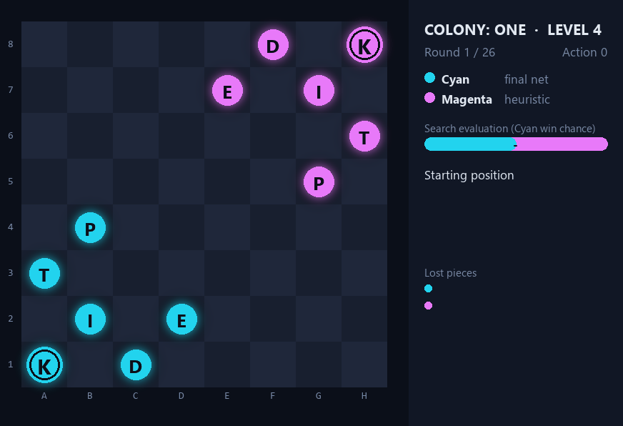
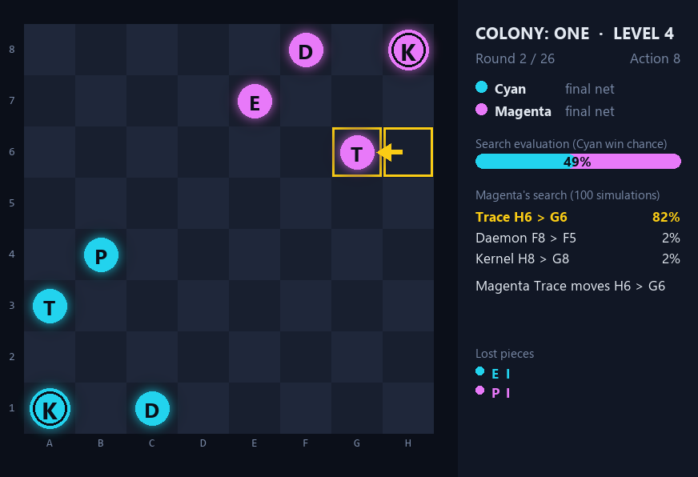
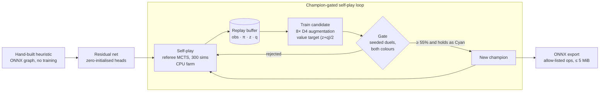

<div align="center">

# StrivonCCC

**An AlphaZero-style policy/value network for _Colony: One_, built for the Cloudflight Coding Contest 2026**


<sub>The final network playing itself. The side panel shows the mover's top candidates from its 100-simulation search and how the search rates the position. Magenta's Trace finally snipes the Cyan Kernel from range.</sub>

</div>

---

## Contents

- [The game](#the-game)
- [The challenge](#the-challenge)
- [How the model works](#how-the-model-works)
- [Training pipeline](#training-pipeline)
- [Results and lessons](#results-and-lessons)
- [Repository layout](#repository-layout)
- [Getting started](#getting-started)

## The game

_Colony: One_ is a two-player strategy game on an 8×8 board. **Cyan** and **Magenta** each command six pieces, and a turn is **two actions** by the same side. Capture the enemy **Kernel** to win.

| Piece | Moves | Captures |
|---|---|---|
| **P**ing | orthogonally, up to 2, empty squares only | diagonally, up to 2, moving onto the target |
| **D**aemon | slides orthogonally, up to 3 | shoots an adjacent enemy; move-captures at distance 2–3 |
| **E**xploit | 2+1 L-jump, leaping over pieces | moves onto the target |
| **T**race | one orthogonal step | shoots diagonally at range 2–3 |
| **I**ce | orthogonally or diagonally, up to 2 | moves onto the target |
| **K**ernel | one square in any direction | moves onto the target |

Three rules make the game sharp:

- **Bodyguards.** An attack on a Kernel kills an adjacent friendly piece instead, if one is standing guard.
- **The firewall.** After rounds 8, 16, 24 and 26 the outermost open ring locks (8×8 → 6×6 → 4×4 → 2×2 → closed), destroying everything standing on it.
- **Bare Kernels.** When only the two Kernels remain, proximity and distance to the centre decide the game. Magenta wins every tie, which offsets Cyan's first move.

## The challenge

Every team submits **one ONNX file**. The referee wraps it in its own PUCT Monte-Carlo tree search and plays a live Glicko-2 tournament against the other teams' models. The model never picks moves itself: it only guides the search.

| Contract | |
|---|---|
| Input | `observation (B, 16, 8, 8)`: piece planes, locked squares, actions left, firewall urgency, side to move |
| Outputs | `policy (B, 4096)` raw logits over `from_square × to_square`; `value (B,)` in [-1, 1] for the side to move |
| Search | 100 simulations per action in Level 4, one CPU thread, a strict CPU-time budget per match |
| Format | ≤ 5 MiB, opset 13–18, allow-listed operators only, no control flow |

The first levels were small puzzles, which [`solver/solver.py`](solver/solver.py) searches exactly. Level 3 used a hand-built evaluator, and Level 4 is the tournament this repository is mostly about.

## How the model works

<div align="center">


<sub>The learned network (Cyan) against the hand-built heuristic it was trained on top of (Magenta). Cyan loses nothing, and Magenta's Kernel is finally caught on the ring the firewall locks.</sub>
</div>

The final model is a **residual network on top of a hand-built heuristic**, exported as a single ONNX graph:

```text
policy logits = heuristic prior(obs)        + net_policy(obs)
value         = tanh(heuristic pre-value(obs) + net_value(obs))
```

- **The heuristic** ([`src/build3.py`](src/build3.py)) is written directly as an ONNX graph, with no training. It scores material, centrality, guard-aware Kernel threats and firewall danger, using 13×13 "reach" convolutions that encode every piece's movement pattern. Its policy prior prefers captures and avoids squares the enemy can hit: `logit[from, to] = a·enemyValue[to] − b·ownValue[from]·enemyReach[to]`.
- **The net** is an 80-channel, 6-block residual tower (≈ 0.73 M parameters) whose output heads start at zero. At step 0 the model is exactly the heuristic, and self-play only has to learn the corrections.
- **It fits the budget.** A batch of 8 positions takes about 7 ms on one CPU thread, so a full 100-simulation match stays well inside the referee's CPU limit.

<div align="center">


<sub>One decision, frozen. Magenta's Trace shoots H6 → F4 and takes Cyan's Ice. The search spent 81% of its visits on that move.</sub>
</div>

## Training pipeline



1. **Self-play** ([`src/selfplay.py`](src/selfplay.py), [`gate/spfarm.sh`](gate/spfarm.sh)): the current champion plays itself with the referee's own search at 300 simulations. Every position is stored with its visit distribution π, the game result z and the root search value q.
2. **Training** ([`src/train2.py`](src/train2.py), [`gate/arch.py`](gate/arch.py)): a cross-entropy loss on π and MSE on `(z + q) / 2`. All 8 board symmetries are used, since the rules are exactly D4-invariant ([`src/symcheck.py`](src/symcheck.py)). Each candidate warm-starts from the champion.
3. **Gating** ([`gate/gate.py`](gate/gate.py), [`src/champloop.sh`](src/champloop.sh)): seeded pairs of games, one with each colour. A candidate replaces the champion only if it wins at least 55% overall and doesn't collapse as Cyan.
4. **Export**: graph surgery keeps the file on the operator allow-list. Constant nodes become initializers ([`src/fixconst.py`](src/fixconst.py)), and fp16 weight storage is available ([`gate/fp16w.py`](gate/fp16w.py)).

## Results and lessons

### Progression

Every score below comes from seeded head-to-head duels with the referee's search at 100 simulations, with each model playing both colours.

| Stage | Model | Opponent | Score |
|---|---|---|---|
| 1 | Level 4 heuristic (hand-built) | Level 3 evaluator | **92.5%** (111 / 120) |
| 2 | 48×4 residual nets, 22 self-play generations | the previous generation | typically 52–69% per step: gen 4 vs gen 1 **82%**, gen 9 vs gen 6 **72%**, gen 21 vs gen 19 **64.8%** (250 games) |
| 3 | 80×6 net trained from scratch on all self-play data | best 48×4 net (gen 22) | 50% (a tie) |
| 4 | 80×6, first self-play generation | 48×4 gen 21 | **74%** (185 / 250) |
| 5 | champion-gated loop: champion 4 | stage 4 | **63.2%** (158 / 250) |
| 6 | champion 8 | champion 4 | **69.5%** (139 / 200) |
| 7 | **final model** (champion 14) | champion 11 | **73%** (109 / 150; 53 / 75 as Cyan, 56 / 75 as Magenta) |

Against the hand-built heuristic the final model wins about 100% of games, and against the strongest net from the other lineage (48×4 gen 21) it wins 81%.

### Side experiments

| Head-to-head (referee search, 100 sims, both colours) | Score |
|---|---|
| Pure distillation net (48×4, trained only on the heuristic's search) vs. the heuristic | **98.5%** (197 / 200) |
| Opening-prior sharpening (logits ×2.5 during the referee's sampled warm-up) | 53.4% (1,540 games) |
| Muon + decoupled weight decay vs. AdamW (same net, same data) | 57.2% (343 / 600) |

### What mattered most

- **Residual on the heuristic was the biggest lever.** Nets trained from scratch levelled off at similar strength whatever the architecture. Extra capacity (80×6) only paid off inside the self-play loop.
- **Value targets.** Mixing the game result with the root search value, `(z + q) / 2`, generalised better than `z` alone, which overfits.
- **Fine-tuning recipe.** Two epochs on the last three generations at lr 5e-4 worked. Long runs or stale data made champions regress.
- **Gate against outsiders, with a colour split.** Candidates that beat their own parent 55–70% sometimes won only 24–41% as Magenta against an older net from another line.
- **Ensembles and symmetry TTA** ([`grafts/ensemble.py`](grafts/ensemble.py), [`gate/ens.py`](gate/ens.py)) were worth +5 to +12 points, but cost about 60% more CPU per call. That is too close to the match time limit, so the final submission is a single network.
- **Exact rule-derived grafts** (tactics, firewall, endgame; [`grafts/obuild.py`](grafts/obuild.py)) were engine-exact but neutral on strong nets, which already rate forced kills near +1.
- **Deployment constraints.** int8 quantization is impossible, since no quantized operators are allow-listed. fp16 weights plus a Cast halve the file at the same speed. GPU-batched self-play was only about 1.4× faster, because at 300 simulations the tree search dominates, not the network.

## Repository layout

```text
StrivonCCC/
├── models/                  submitted ONNX models
│   ├── level4_final.onnx        final Level 4 model (80×6 residual net + heuristic)
│   ├── level4_heuristic.onnx    hand-built Level 4 evaluator (src/build3.py)
│   └── level3_model.onnx        hand-built Level 3 evaluator (src/build2.py)
├── src/                     heuristics, self-play, training, evaluation, rendering
│   ├── build3.py                Level 4 heuristic as an ONNX graph
│   ├── selfplay.py              self-play data (obs, legal mask, π, z, q)
│   ├── train2.py                residual-on-heuristic training + merged export
│   ├── champloop.sh             champion-gated self-play loop
│   ├── duel.py, bench.py        head-to-head matches, both colours, in parallel
│   ├── showcase.py              plays a game and renders the GIFs above
│   └── distill_*.py             pure-network distillation experiment
├── gate/                    gating duels, architecture search, graph surgery, experiment specs
├── grafts/                  ONNX graph-building kit: equation grafts, ensembles, model checks
├── solver/                  exact solver for the early puzzle levels
└── assets/                  README media
```

## Getting started

The official _Colony: One_ environment (engine, referee MCTS, validator) and the Level 4 start position belong to the contest and are **not redistributed here**. Place them at `src/env/` and `scenes/level-4_scene.json`.

```bash
python -m venv .venv && source .venv/bin/activate   # Windows: .venv\Scripts\activate
pip install -r requirements.txt
pip install -e src/env                              # the contest environment

# check a model against the submission contract
python src/env/tools/validate_submission.py models/level4_final.onnx

# head-to-head: 20 seeded pairs, each model plays both colours
python src/duel.py models/level4_final.onnx models/level4_heuristic.onnx 20

# render a game like the ones above
python src/showcase.py models/level4_final.onnx models/level4_final.onnx assets/selfplay.gif \
    --seed 2 --names "final net,final net" --still assets/decision.png --still-at 8

# one generation of the loop: self-play, train a candidate, gate it
python src/selfplay.py models/level4_final.onnx data/gen1 8 4 300
python src/train2.py --heur models/level4_heuristic.onnx --out cand.onnx --ch 80 --blocks 6 \
    --epochs 2 --lr 5e-4 --init champion.onnx.pt "data/gen1_*.npz"
python gate/gate.py cand.onnx models/level4_final.onnx --pairs 100
```

The shell scripts in `src/` and `gate/` drive long runs on a multi-core Linux server and assume the repository is checked out at `/root/strivon`.

## Acknowledgements

- [Cloudflight Coding Contest](https://codingcontest.org/) for the challenge.
- The _Colony: One_ environment is © Paul Puntschart, licensed for non-commercial use, and is not part of this repository.
- Ideas borrowed from AlphaZero, KataGo (global pooling, playout-cap randomization) and Leela Chess Zero (squeeze-excitation, bilinear from/to policy heads).
